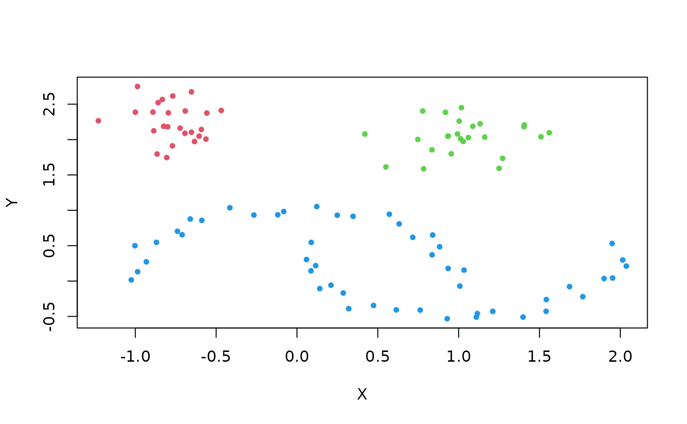
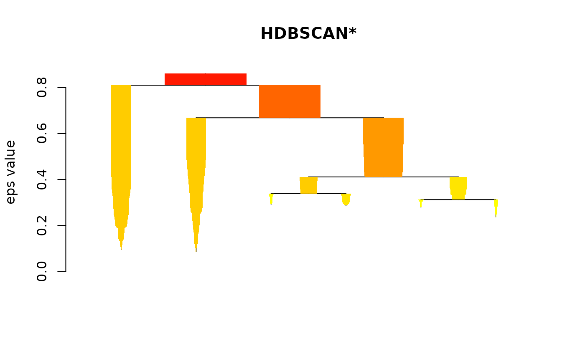
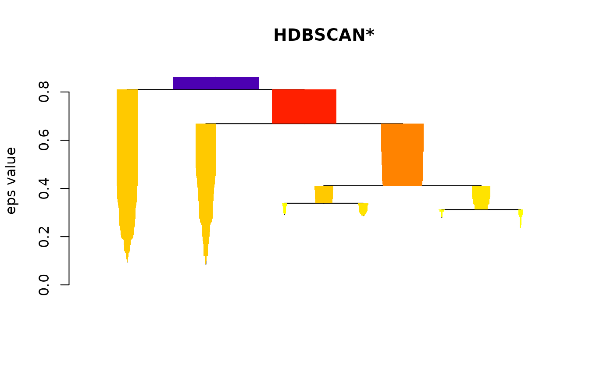
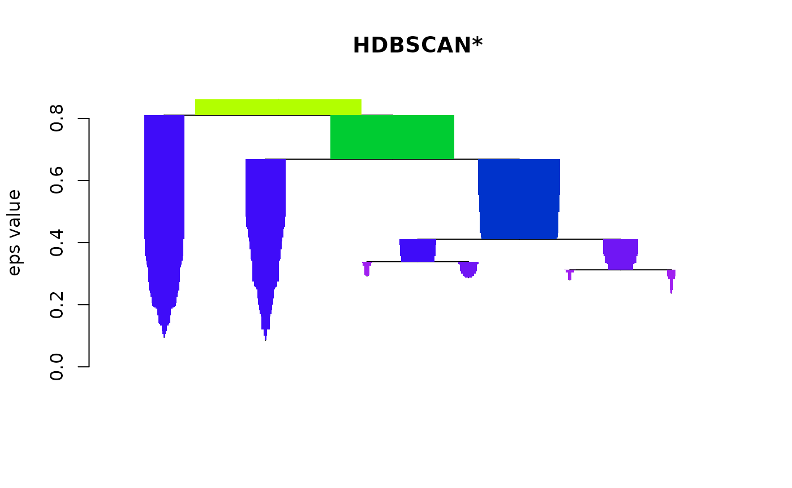
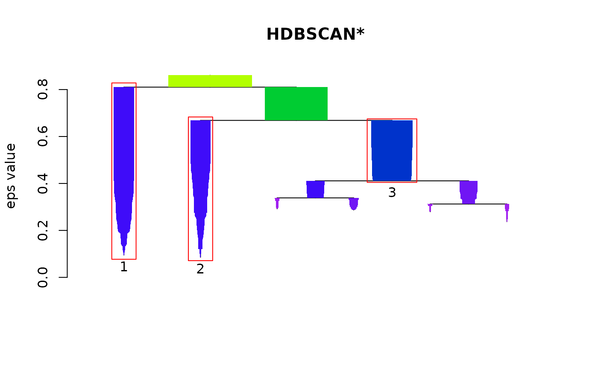
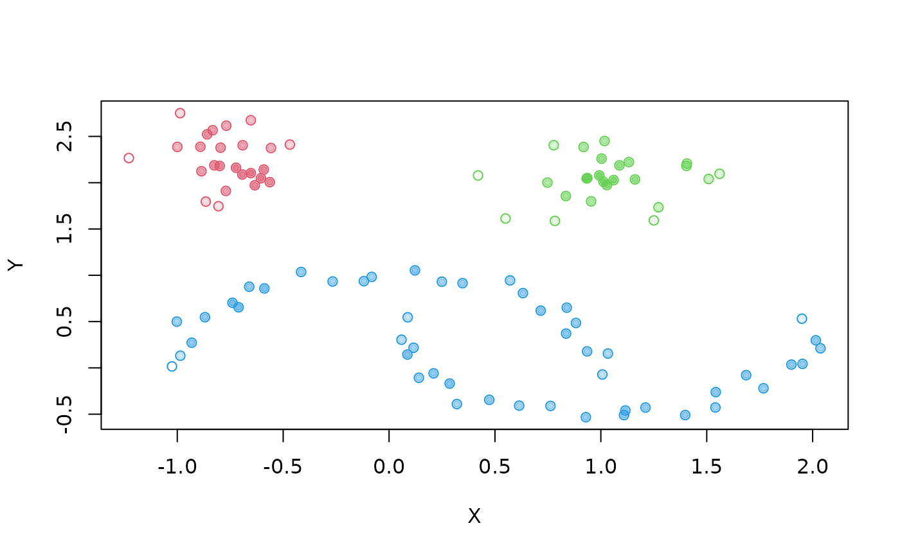
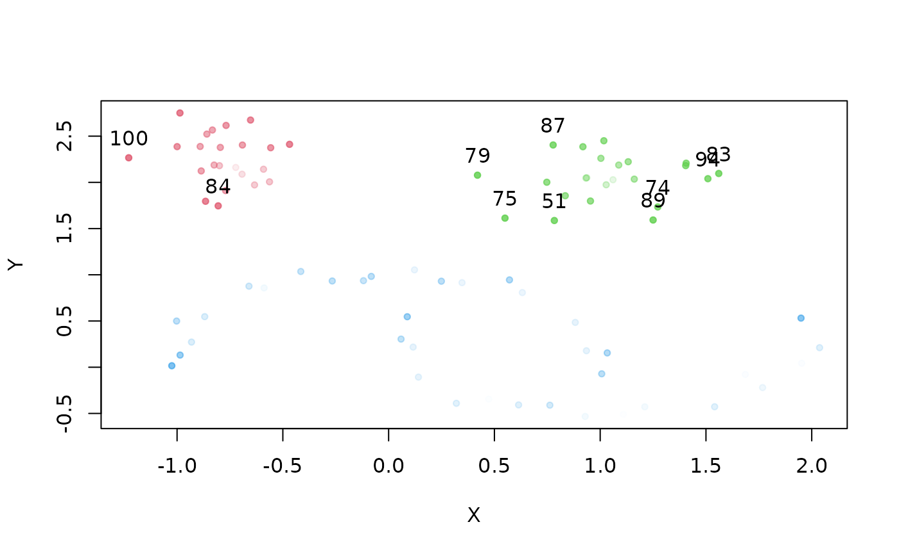
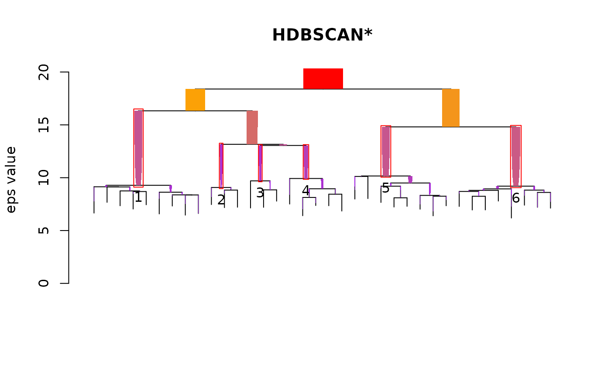

# Using Hierarchical DBSCAN (HDBSCAN)

The dbscan package \[6\] provides a fast implementation of Hierarchical
DBSCAN (HDBSCAN) and related algorithms for R. Nearest-neighbor searches
use k-d trees, and for data matrices the minimum spanning tree (MST) is
computed with Prim’s algorithm without materializing the full distance
matrix. This vignette introduces the corresponding interface. For an
introduction to the concepts of the algorithm, see the [HDBSCAN
documentation](https://hdbscan.readthedocs.io/en/latest/how_hdbscan_works.html)
of the Python library hdbscan. We use the same sample dataset as that
documentation:

``` r

library("dbscan")
```

    ## 
    ## Attaching package: 'dbscan'

    ## The following object is masked from 'package:stats':
    ## 
    ##     as.dendrogram

``` r

data("moons")
plot(moons, pch=20)
```


To run HDBSCAN, pass the data and the single parameter `minPts` to
[`hdbscan()`](https://michael.hahsler.net/dbscan/reference/hdbscan.md).

``` r

  cl <- hdbscan(moons, minPts = 5)
  cl
```

    ## HDBSCAN clustering for 100 objects.
    ## Parameters: minPts = 5
    ## The clustering contains 3 cluster(s) and 0 noise points.
    ## 
    ##  1  2  3 
    ## 25 25 50 
    ## 
    ## Available fields: cluster, minPts, coredist, cluster_scores,
    ##                   membership_prob, outlier_scores, hc

The flat clustering is stored in the `cluster` component. Noise points
are assigned the cluster id 0, so we add 1 to obtain valid color
indices.

``` r

 plot(moons, col=cl$cluster+1, pch=20)
```



The clustering recovers the intuitive, arbitrarily shaped groups in the
data.

## The HDBSCAN\* Hierarchy

The `hdbscan` object contains a hierarchical representation of all
DBSCAN\* clusterings for the given `minPts`. The hierarchy is stored in
the `hc` component as an `hclust` object (see
[`stats::hclust()`](https://rdrr.io/r/stats/hclust.html)).

``` r

cl$hc
```

    ## 
    ## Call:
    ## mst_mrdist(x = x, minPts = minPts, coredist = coredist)
    ## 
    ## Cluster method   : robust single 
    ## Distance         : mutual reachability (euclidean) 
    ## Number of objects: 100

The object can be used with functions that accept `hclust` objects.
Note, however, that the hierarchy is a single-linkage hierarchy under
the mutual reachability distance (see \[3\]), which
[`stats::hclust()`](https://rdrr.io/r/stats/hclust.html) does not
provide as a linkage method. It is called the “HDBSCAN\* hierarchy” in
\[3, 4\] and can be visualized with the plot method for `hclust` objects
from the stats package:

``` r

plot(cl$hc, main="HDBSCAN* Hierarchy")
```


## DBSCAN\* vs. Cutting the HDBSCAN\* Hierarchy

A global cut of the HDBSCAN\* hierarchy at height \\\varepsilon\\ is
equivalent to running DBSCAN\* (DBSCAN \[1\] without border points) with
\\\varepsilon\\ and the same \\minPts\\. We can verify this empirically.
[`stats::cutree()`](https://rdrr.io/r/stats/cutree.html) does not label
singletons as noise, so the function below assigns noise (cluster id 0)
to all points whose core distance exceeds \\\varepsilon\\. The
clusterings are then compared across all cut heights.

``` r

cl <- hdbscan(moons, minPts = 5)
check <- rep(FALSE, nrow(moons)-1)
core_dist <- kNNdist(moons, k=5-1)

## cutree doesn't distinguish noise as 0, so we make a new method to do it manually 
cut_tree <- function(hcl, eps, core_dist){
  cuts <- unname(cutree(hcl, h=eps))
  cuts[which(core_dist > eps)] <- 0 # Use core distance to distinguish noise
  cuts
}

eps_values <- sort(cl$hc$height, decreasing = TRUE)+.Machine$double.eps ## Machine eps for consistency between cuts
for (i in 1:length(eps_values)) { 
  cut_cl <- cut_tree(cl$hc, eps_values[i], core_dist)
  dbscan_cl <- dbscan(moons, eps = eps_values[i], minPts = 5, borderPoints = FALSE) # DBSCAN* doesn't include border points
  
  ## Use run length encoding as an ID-independent way to check ordering
  check[i] <- (all.equal(rle(cut_cl)$lengths, rle(dbscan_cl$cluster)$lengths) == "TRUE")
}
print(all(check == TRUE))
```

    ## [1] TRUE

## Simplified Cluster Tree

The full HDBSCAN\* hierarchy becomes unwieldy for larger datasets
because every observation is a leaf. The
[`plot()`](https://rdrr.io/r/graphics/plot.default.html) method for
`hdbscan` objects instead shows the simplified (condensed) cluster tree
(see \[3, 4\]), which displays **cluster-wide** changes over all values
of \\\varepsilon\\. It is the default visualization:

``` r

 plot(cl)
```



The color gradient can be changed,

``` r

 plot(cl, gradient = c("yellow", "orange", "red", "blue"))
```



the widths scaled to the output device,

``` r

plot(cl, gradient = c("purple", "blue", "green", "yellow"), scale=1.5)
```



and the clusters selected for the flat solution (those with maximal
stability \[2\]) can be outlined:

``` r

plot(cl, gradient = c("purple", "blue", "green", "yellow"), show_flat = TRUE)
```



## Cluster Stability Scores

The stability scores are indexed by the cluster labels of the condensed
tree. These labels differ from the cluster ids in the `cluster`
component. The scores are the stability values *before* the bottom-up
traversal of the tree that updates them based on the stability of the
child clusters.

``` r

print(cl$cluster_scores)
```

    ##         1         2         3 
    ## 110.70613  90.86559  45.62762

The membership “probabilities” of the individual points are stored in
`membership_prob`. They are derived from the core distances and are not
probabilities in a statistical sense.

``` r

  head(cl$membership_prob)
```

    ## [1] 0.4354753 0.2893287 0.4778663 0.4035933 0.4574012 0.4904582

They can be used to visualize the degree of cluster membership, for
example, by mapping it to the transparency of the points.

``` r

  plot(moons, col=cl$cluster+1, pch=21)
  colors <- mapply(function(col, i) adjustcolor(col, alpha.f = cl$membership_prob[i]), 
                   palette()[cl$cluster+1], seq_along(cl$cluster))
  points(moons, col=colors, pch=20)
```



## Global-Local Outlier Score from Hierarchies

The Global-Local Outlier Score from Hierarchies (GLOSH) \[4\] assigns an
outlier score to each point based on both local *and* global properties
of the hierarchy. The scores are available in the `outlier_scores`
component. In the plot below, the opacity of a point represents its
outlier score, and the ten points with the highest scores are labeled.

**Note:** GLOSH is computed from the hierarchy. It is not simply the
complement of the membership probabilities, which are based on the core
distances of the points within the selected clusters. Noise points
(points not assigned to any cluster) are taken into account in the
definition of an outlier.

``` r

  top_outliers <- order(cl$outlier_scores, decreasing = TRUE)[1:10]
  colors <- mapply(function(col, i) adjustcolor(col, alpha.f = cl$outlier_scores[i]), 
                   palette()[cl$cluster+1], seq_along(cl$cluster))
  plot(moons, col=colors, pch=20)
  text(moons[top_outliers, ], labels = top_outliers, pos=3)
```



## A Larger Example

A larger dataset illustrates the advantages of HDBSCAN more clearly. The
`DS3` dataset was published as a benchmark for the Chameleon clustering
algorithm \[5\]. Its shapes are easy to identify visually, but many
clustering algorithms fail to recover them.

``` r

data("DS3")
plot(DS3, pch=20, cex=0.25)
```


With `minPts = 25`, HDBSCAN finds the 6 clusters in the data:

``` r

cl2 <- hdbscan(DS3, minPts = 25)
cl2
```

    ## HDBSCAN clustering for 8000 objects.
    ## Parameters: minPts = 25
    ## The clustering contains 6 cluster(s) and 814 noise points.
    ## 
    ##    0    1    2    3    4    5    6 
    ##  814 1585  618  614  924 1656 1789 
    ## 
    ## Available fields: cluster, minPts, coredist, cluster_scores,
    ##                   membership_prob, outlier_scores, hc

As before, we mark noise points and map the membership probabilities to
opacity.

``` r

  plot(DS3, col=cl2$cluster+1, 
       pch=ifelse(cl2$cluster == 0, 8, 1), # Mark noise as star
       cex=ifelse(cl2$cluster == 0, 0.5, 0.75), # Decrease size of noise
       xlab=NA, ylab=NA)
  colors <- sapply(1:length(cl2$cluster), 
                   function(i) adjustcolor(palette()[(cl2$cluster+1)[i]], alpha.f = cl2$membership_prob[i]))
  points(DS3, col=colors, pch=20)
```


The simplified cluster tree is particularly useful for larger datasets:

``` r

  plot(cl2, scale = 3, gradient = c("purple", "orange", "red"), show_flat = TRUE)
```



## Performance

The computationally intensive steps of HDBSCAN are implemented in C++
using Rcpp. Core distances are computed with a k-d tree based
k-nearest-neighbor search. For a data matrix,
[`hdbscan()`](https://michael.hahsler.net/dbscan/reference/hdbscan.md)
then constructs the MST of the mutual reachability graph with Prim’s
algorithm and computes the (Euclidean) mutual reachability distances on
the fly (see
[`mst_mrdist()`](https://michael.hahsler.net/dbscan/reference/mst_dist.md)).
The \\n \times n\\ distance matrix is never stored, so memory use is
\\O(nd)\\ for \\n\\ points in \\d\\ dimensions. The running time is
still quadratic in \\n\\.

If a `dist` object is supplied instead of a data matrix, its distances
are used directly. This supports other distance measures, but requires
\\O(n^2)\\ memory.

## References

1.  Martin Ester, Hans-Peter Kriegel, Joerg Sander, Xiaowei Xu (1996). A
    Density-Based Algorithm for Discovering Clusters in Large Spatial
    Databases with Noise. Institute for Computer Science, University of
    Munich. Proceedings of 2nd International Conference on Knowledge
    Discovery and Data Mining (KDD-96).
2.  Campello, Ricardo JGB, Davoud Moulavi, Arthur Zimek, and Jörg
    Sander. “A framework for semi-supervised and unsupervised optimal
    extraction of clusters from hierarchies.” Data Mining and Knowledge
    Discovery 27, no. 3 (2013): 344-371.
3.  Campello, Ricardo JGB, Davoud Moulavi, and Joerg Sander.
    “Density-based clustering based on hierarchical density estimates.”
    In Pacific-Asia Conference on Knowledge Discovery and Data Mining,
    pp. 160-172. Springer Berlin Heidelberg, 2013.
4.  Campello, Ricardo JGB, Davoud Moulavi, Arthur Zimek, and Jörg
    Sander. “Hierarchical density estimates for data clustering,
    visualization, and outlier detection.” ACM Transactions on Knowledge
    Discovery from Data (TKDD) 10, no. 1 (2015): 5.
5.  Karypis, George, Eui-Hong Han, and Vipin Kumar. “Chameleon:
    Hierarchical clustering using dynamic modeling.” Computer 32, no. 8
    (1999): 68-75.
6.  Hahsler M, Piekenbrock M, Doran D (2019). “dbscan: Fast
    Density-Based Clustering with R.” Journal of Statistical Software,
    91(1), 1-30. doi:
    [10.18637/jss.v091.i01](https://doi.org/10.18637/jss.v091.i01)
