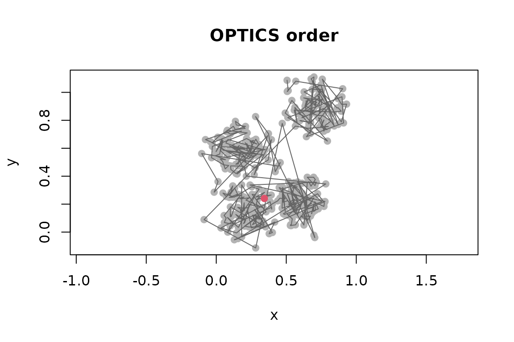
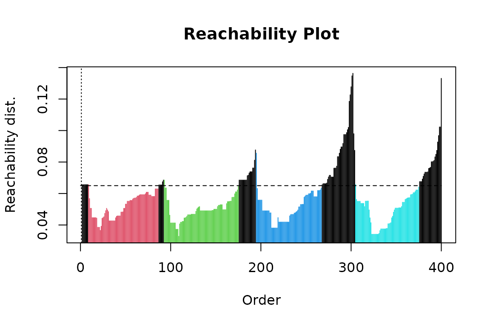
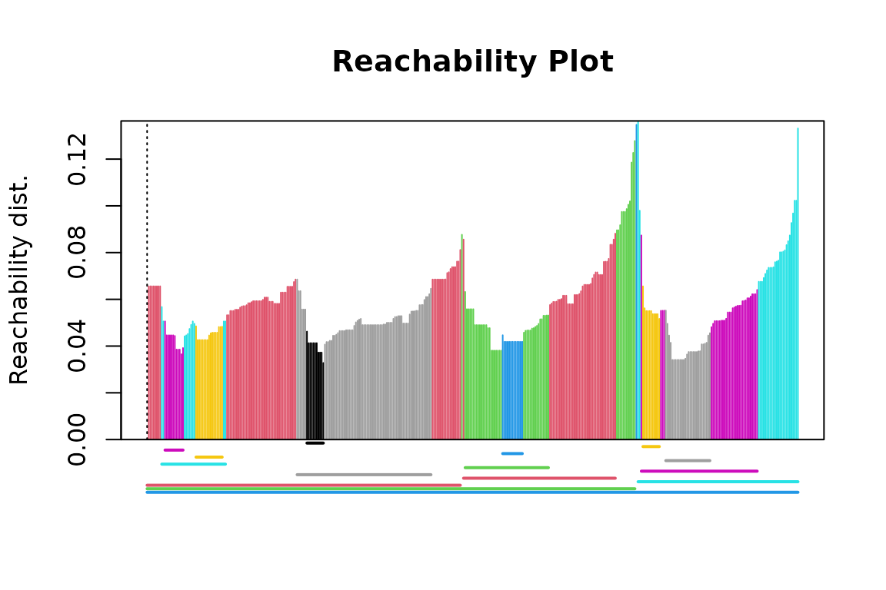
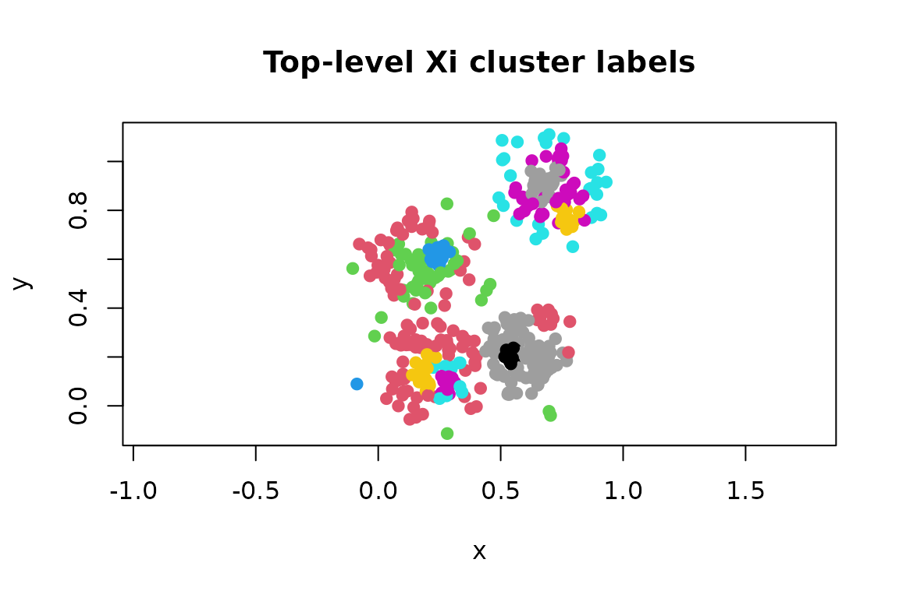

# Ordering Points With OPTICS

OPTICS (Ordering Points To Identify the Clustering Structure) is a
density-based ordering algorithm. Like DBSCAN, it describes dense
regions in terms of an epsilon neighborhood and a minimum number of
points. Unlike DBSCAN, its main result is not a single clustering.
OPTICS orders observations and records their reachability distances,
revealing clustering structure over a range of density levels.

This vignette shows how to create and interpret an OPTICS ordering and
how to extract flat or hierarchical clusters from it.

## Create an OPTICS ordering

We generate four compact groups for a small reproducible example.

``` r

set.seed(2)
n <- 400
x <- cbind(
  x = runif(4, 0, 1) + rnorm(n, sd = 0.1),
  y = runif(4, 0, 1) + rnorm(n, sd = 0.1)
)

plot(x, asp = 1, main = "Example data")
```


[`optics()`](https://michael.hahsler.net/dbscan/reference/optics.md)
accepts a numeric matrix or data frame. For numeric data it uses
Euclidean distance and a fast k-d tree search.

``` r

opt <- optics(x, minPts = 10)
opt
#> OPTICS ordering/clustering for 400 objects.
#> Parameters: minPts = 10, eps = Inf, eps_cl = NA, xi = NA
#> Available fields: order, reachdist, coredist, predecessor, minPts, eps,
#>                   eps_cl, xi
```

The most important result components are:

- `order`: row numbers of the observations in OPTICS order;
- `reachdist`: each observation’s reachability distance; and
- `coredist`: each observation’s core distance.

The distance vectors use the original row order. For example,
reachability distances in OPTICS order are obtained with:

``` r

head(opt$order, 10)
#>  [1]   1  13  17  21  89 149 165 193 209  57
head(opt$reachdist[opt$order], 10)
#>  [1]        Inf 0.06559013 0.06559013 0.06559013 0.06559013 0.06559013
#>  [7] 0.06559013 0.06559013 0.06559013 0.05673844
```

The first reachability distance is undefined because the first point has
no predecessor. It is stored as `Inf`.

## Read the reachability plot

Plotting an OPTICS object produces a reachability plot. Each vertical
bar is one observation, arranged in OPTICS order rather than input
order.

``` r

plot(opt)
```


Low-reachability valleys represent dense groups. Peaks separate groups,
and deeper valleys represent denser structure. The plot is therefore
best read as a density landscape, not as a scatter plot or a sequence in
the original data.

The ordering can also be displayed in the original coordinate space.
This is mainly useful for understanding the algorithm; the reachability
plot is usually clearer for real data.

``` r

plot(x, col = "grey70", pch = 19, asp = 1, main = "OPTICS order")
lines(x[opt$order, ], col = "grey40")
points(x[opt$order[1], , drop = FALSE], pch = 19, col = 2)
```



## Choose `minPts`

`minPts` controls the scale at which density is evaluated. It includes
the point itself, so `minPts = 10` uses the distance to the ninth other
nearest neighbor for the core-distance calculation. Larger values
average over larger neighborhoods and generally produce a smoother
reachability plot; smaller values reveal finer structure but are more
sensitive to local variation.

## Considerations for `eps`

OPTICS does not restrict `eps`, the maximum neighborhood radius explored
by the algorithm. This is implemented by the default `eps = Inf` and
typically should not be changed.

The standard OPTICS algorithm runs an \\\epsilon\\-range query for every
point that it visits, sorts the returned distances to obtain the core
distance, and then updates the reachability distances of the unvisited
neighbors. With `eps = Inf`, each query returns all \\n\\ points, so
this costs \\O(n^2 \log n)\\ time and repeatedly allocates neighbor
lists of size \\n\\.

An unlimited neighborhood makes these queries unnecessary. If there are
at least `minPts` points, every point is a core point, and the
reachability distance of an unvisited point \\o\\ from a visited point
\\p\\ is

\\\mathrm{reach}(p, o) = \max\left(\mathrm{coredist}(p),\\ d(p,
o)\right).\\

OPTICS always visits next the unvisited point with the smallest
reachability distance. This is exactly Prim’s algorithm for a minimum
spanning tree with the weights above, starting from the first
observation. The order of the observations is the order in which Prim’s
algorithm adds them, the reachability distance is the weight of the
added edge, and the predecessor is the visited point that provided the
smallest weight. As in the general implementation, ties are resolved in
favor of the observation with the lower row number.

This implementaion of
[`optics()`](https://michael.hahsler.net/dbscan/reference/optics.md)
therefore proceeds in two steps if `eps = Inf` (the default):

1.  The core distances of all points are computed with a
    \\k\\-nearest-neighbor search (\\k = \mathtt{minPts} - 1\\, using
    the k-d tree).
2.  Prim’s algorithm scans the unvisited points once for every visited
    point and calculates the needed distances on the fly. A distance
    matrix is never created, so only \\O(n)\\ memory is needed in
    addition to the data. For data given as a `dist` object, the
    existing distances are used.

The running time is still quadratic in \\n\\, but without the sorting
and neighbor lists.

For large data sets, manually supplying a smaller upper bound can reduce
computation, but may lead to missing reachability distances and
warnings. Multiple dashed bars in the reachability plot indicate
undefined distances and usually mean that `eps` is too small. The first
dashed bar is expected.

## Extract a DBSCAN-like clustering

[`extractDBSCAN()`](https://michael.hahsler.net/dbscan/reference/optics.md)
cuts the reachability plot at a global threshold `eps_cl`. This does not
rerun OPTICS, so several thresholds can be explored using the same
ordering. The extraction closely resembles DBSCAN with the same `minPts`
and epsilon, although OPTICS can leave some DBSCAN border points
unassigned.

``` r

opt_db <- extractDBSCAN(opt, eps_cl = 0.065)
opt_db
#> OPTICS ordering/clustering for 400 objects.
#> Parameters: minPts = 10, eps = Inf, eps_cl = 0.065, xi = NA
#> The clustering contains 4 cluster(s) and 95 noise points.
#> 
#>  0  1  2  3  4 
#> 95 78 83 73 71 
#> 
#> Available fields: order, reachdist, coredist, predecessor, minPts, eps,
#>                   eps_cl, xi, cluster
plot(opt_db)
```



The dashed horizontal line is the extraction threshold. Bars are colored
by cluster; cluster `0` is noise and appears black with the default
palette. Cluster assignments are stored in original data order.

``` r

table(opt_db$cluster)
#> 
#>  0  1  2  3  4 
#> 95 78 83 73 71

hullplot(
  x,
  opt_db,
  asp = 1,
  main = "Clusters extracted at eps_cl = 0.065"
)
```


Changing the cut illustrates structure at a different density level:

``` r

opt_db_wide <- extractDBSCAN(opt, eps_cl = 0.07)
c(
  clusters = max(opt_db_wide$cluster),
  noise = sum(opt_db_wide$cluster == 0)
)
#> clusters    noise 
#>        3       60
```

Choose `eps_cl <= opt$eps`. A useful threshold crosses stable valleys
below the peaks that separate them. If a single global cut cannot
represent groups of differing density, use the Xi extraction described
next.

## Extract clusters with the Xi method

[`extractXi()`](https://michael.hahsler.net/dbscan/reference/optics.md)
identifies relative steep-down and steep-up regions in the reachability
plot. The `xi` value is the minimum relative change in reachability used
to recognize a boundary. This can find nested clusters and clusters at
different density levels without selecting one global distance
threshold.

``` r

opt_xi <- extractXi(opt, xi = 0.05)
opt_xi
#> OPTICS ordering/clustering for 400 objects.
#> Parameters: minPts = 10, eps = Inf, eps_cl = NA, xi = 0.05
#> The clustering contains 15 cluster(s) and 0 noise points.
#> 
#> Available fields: order, reachdist, coredist, predecessor, minPts, eps,
#>                   eps_cl, xi, clusters_xi, cluster
opt_xi$clusters_xi
#>    start end cluster_id
#> 1      1 193          1
#> 2      1 300          2
#> 3      1 400          3
#> 4     10  49          4
#> 5     12  23          5
#> 6     31  47          6
#> 7     93 175          7
#> 8     99 109          8
#> 9    195 288          9
#> 10   196 247         10
#> 11   219 231         11
#> 12   302 400         12
#> 13   304 375         13
#> 14   305 315         14
#> 15   319 346         15
plot(opt_xi)
```



Each row of `clusters_xi` gives the start and end positions of a cluster
in OPTICS order. These intervals can be nested. The colored line
segments below the reachability plot show the intervals, while `cluster`
contains a convenient non-nested labeling in original data order for
plotting.

``` r

hullplot(x, opt_xi, asp = 1, main = "Optics Xi Clusters")
#> Warning in hullplot(x, opt_xi, asp = 1, main = "Optics Xi Clusters"): Not
#> enough colors. Some colors will be reused.
```



Set `minimum = TRUE` to retain minimal clusters that do not contain
other Xi clusters. This is useful when a non-overlapping, fine-grained
solution is needed.

``` r

opt_xi_min <- extractXi(opt, xi = 0.05, minimum = TRUE)
opt_xi_min
#> OPTICS ordering/clustering for 400 objects.
#> Parameters: minPts = 10, eps = Inf, eps_cl = NA, xi = 0.05
#> The clustering contains 6 cluster(s) and 308 noise points.
#> 
#> Available fields: order, reachdist, coredist, predecessor, minPts, eps,
#>                   eps_cl, xi, clusters_xi, cluster
plot(opt_xi_min)
```


``` r


hullplot(x, opt_xi_min, asp = 1, main = "Optics Xi (minimal clusters)")
#> Warning in hullplot(x, opt_xi_min, asp = 1, main = "Optics Xi (minimal
#> clusters)"): Not enough colors. Some colors will be reused.
```


The predecessor correction is enabled by default and removes a known
artifact of the original Xi extraction procedure. It should normally
remain enabled.

## Convert the ordering to a dendrogram

An OPTICS reachability structure can be represented as a dendrogram.
This is often convenient for smaller data sets or for code that works
with standard R dendrogram objects.

``` r

dend <- as.dendrogram(opt)
plot(dend, leaflab = "none", ylab = "Reachability distance")
```


Conversion requires a complete reachability structure. If OPTICS was run
with an `eps` that is too small, rerun it with a larger value or the
default before converting.

## Predict labels for new observations

Prediction is available only after
[`extractDBSCAN()`](https://michael.hahsler.net/dbscan/reference/optics.md),
because prediction needs a flat clustering and its global `eps_cl`
threshold. Supply the original training data along with the new
observations.

``` r

new_points <- rbind(
  c(0.2, 0.3),
  c(0.8, 0.8),
  c(2.0, 2.0)
)

predict(opt_db, newdata = new_points, data = x)
#> [1] 1 4 0
```

A new observation receives the label of its nearest non-noise training
point within `eps_cl`; otherwise it is labeled `0`. Apply the same
transformations used for the training data to new observations.

## Use another distance measure

To use a distance other than Euclidean distance, calculate a `dist`
object and pass it to
[`optics()`](https://michael.hahsler.net/dbscan/reference/optics.md).
This uses the supplied pairwise distances rather than the k-d tree
search.

``` r

d <- dist(x, method = "manhattan")
opt_manhattan <- optics(d, minPts = 10)
plot(opt_manhattan)
```

Prediction from a precomputed-distance analysis is not generally
available, because distances from new observations to the training data
are not stored in the `dist` object.

## References

Ankerst, M., Breunig, M. M., Kriegel, H.-P., and Sander, J. (1999).
OPTICS: Ordering Points To Identify the Clustering Structure.
*Proceedings of the 1999 ACM SIGMOD International Conference on
Management of Data*, 49–60.
[doi:10.1145/304181.304187](https://doi.org/10.1145/304181.304187).

Schubert, E. and Gertz, M. (2018). Improving the Cluster Structure
Extracted from OPTICS Plots. *Lernen, Wissen, Daten, Analysen (LWDA
2018)*, 318–329.

Hahsler, M., Piekenbrock, M., and Doran, D. (2019). dbscan: Fast
Density-Based Clustering with R. *Journal of Statistical Software*,
91(1), 1–30.
[doi:10.18637/jss.v091.i01](https://doi.org/10.18637/jss.v091.i01).
